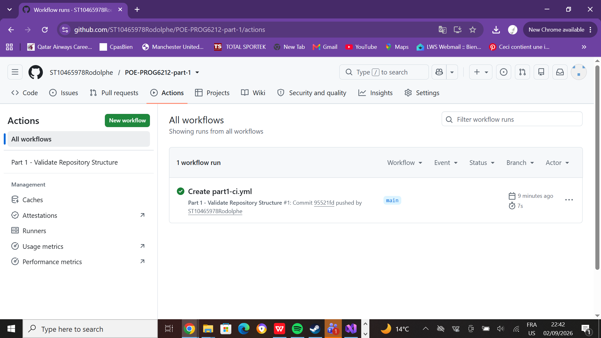
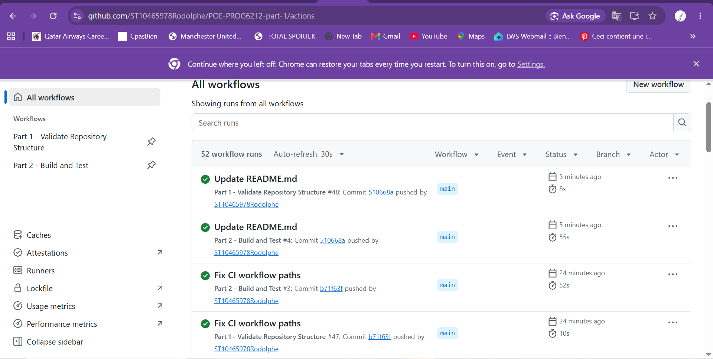

# RaceDay

## Project Description

RaceDay is a full-stack event management system for the South African road running, walking
and cycling community. Event Organisers create and manage events, categories and results,
while Participants browse events, enter them by choosing a category, and track their own
results.

The project is built in three parts:

| Part | Content | Status |
|------|---------|--------|
| Part 1 | ERD, API endpoint plan, SQL script | Complete |
| Part 2 | RESTful ASP.NET Core API, unit tests, CI/CD | Complete |
| Part 3 | MVC web app, Azure Blob Storage, Docker | Not started |

## User Roles

### Organiser
- Registers and logs in with the role Organiser.
- Creates, updates and deletes **their own** events.
- Defines categories (age group or distance) for their own events.
- Views all enrolments for their own events and confirms or cancels them.
- Captures finish times and finishing positions, and views the results of their own events.
- Views and updates their own profile.

### Participant
- Registers and logs in with the role Participant.
- Browses all events and their categories.
- Enters an event by choosing a category.
- Views their own enrolments and their own results.
- Views and updates their own profile.

## Part 1

Planning documents are in the [`docs`](docs) folder:
- ERD: `docs/RaceDay_ERD.drawio.pdf`
- API endpoint plan: `docs/RaceDay API Endpoint Plan.pdf`
- SQL script: `docs/RaceDay_Database.sql`
- Part 1 CI screenshot: 

Part 1 video: https://youtu.be/--MKCmhBOJ8

## Part 2

### Technologies Used
- ASP.NET Core Web API (C#)
- Entity Framework Core (Code First) with SQL Server / LocalDB
- Server-side session authentication and PBKDF2 password hashing
- Swagger (Swashbuckle) with annotations
- xUnit, `WebApplicationFactory` and the EF Core InMemory provider for tests
- GitHub Actions for CI/CD

### Project Structure

```
POE-PROG6212-part-1
|-- .github
|   `-- workflows
|       |-- part1-ci.yml        Part 1: validates the /docs folder
|       `-- ci-part2.yml        Part 2: restore, build and unit tests
|-- docs                        Part 1 planning documents
|-- RaceDay
|   |-- RaceDay.slnx            Visual Studio solution
|   |-- RaceDay.Api
|   |   |-- Controllers         Auth, Users, Events, Categories, Enrolments, Results
|   |   |-- Data                RaceDayDbContext
|   |   |-- Filters             RequireRoleAttribute (role-based access)
|   |   |-- Models              Entities from the ERD
|   |   |-- Services            PasswordHasher and session helpers
|   |   `-- Program.cs
|   |-- RaceDay.Contracts       Request and response DTOs
|   `-- RaceDay.Api.Tests       xUnit tests
|-- .gitignore
`-- README.md
```

### Database Setup
1. Install Visual Studio 2022 (or newer) with the ASP.NET workload. This includes SQL Server LocalDB.
2. The connection string is in `RaceDay/RaceDay.Api/appsettings.json`:
   `Server=(localdb)\MSSQLLocalDB;Database=RaceDayApiDb;Trusted_Connection=True;TrustServerCertificate=True;`
3. In Visual Studio open **Tools > NuGet Package Manager > Package Manager Console**,
   set the default project to `RaceDay.Api` and run:
   ```
   Update-Database
   ```
   This creates `RaceDayApiDb` from the EF Core migrations (Code First).
4. Optional: open the database in SQL Server Management Studio and confirm the tables
   `User`, `Event`, `Category`, `Enrolment`, `Result` and `Route` exist.

### How to Run the API
```bash
git clone <(https://github.com/ST10465978Rodolphe/POE-PROG6212-part-2.git)>
cd POE-PROG6212-part-1
dotnet run --project RaceDay/RaceDay.Api
```
Or open `RaceDay/RaceDay.slnx` in Visual Studio, set `RaceDay.Api` as the startup project
and press F5. Swagger opens at `https://localhost:<port>/swagger` (the port is shown in the
console).

### Authentication
- `POST /api/auth/register` validates the data, checks the role is `Organiser` or
  `Participant`, checks the email is unique, hashes the password with PBKDF2 and saves the user.
- `POST /api/auth/login` verifies the password against the stored hash and stores the
  `UserId` and `Role` in a **server-side session**.
- `POST /api/auth/logout` clears the session.
- The `[RequireRole]` filter protects endpoints: **401** if the user is not logged in,
  **403** if the role is wrong. It runs before model validation.
- Ownership is enforced as well: an Organiser can only change or view data of events they
  own, and the profile and "mine" endpoints always use the `UserId` stored in the session.

### API Endpoints

| Area | Endpoint | Access |
|------|----------|--------|
| Auth | `POST /api/auth/register` | Public |
| Auth | `POST /api/auth/login` | Public |
| Auth | `POST /api/auth/logout` | Public |
| Profile | `GET /api/users/me` | Both roles |
| Profile | `PUT /api/users/me` | Both roles |
| Events | `GET /api/events` | Both roles |
| Events | `GET /api/events/{id}` | Both roles |
| Events | `GET /api/events/mine` | Organiser |
| Events | `POST /api/events` | Organiser |
| Events | `PUT /api/events/{id}` | Organiser (owner) |
| Events | `DELETE /api/events/{id}` | Organiser (owner) |
| Categories | `GET /api/events/{eventId}/categories` | Both roles |
| Categories | `POST /api/events/{eventId}/categories` | Organiser (owner) |
| Categories | `PUT /api/categories/{id}` | Organiser (owner) |
| Categories | `DELETE /api/categories/{id}` | Organiser (owner) |
| Enrolments | `POST /api/enrolments` | Participant |
| Enrolments | `GET /api/enrolments/mine` | Participant |
| Enrolments | `GET /api/enrolments/event/{eventId}` | Organiser (owner) |
| Enrolments | `PUT /api/enrolments/{id}/status` | Organiser (owner) |
| Results | `POST /api/results` | Organiser (owner) |
| Results | `GET /api/results/mine` | Participant |
| Results | `GET /api/results/event/{eventId}` | Organiser (owner) |

#### Differences from the Part 1 plan
- The profile endpoints are `/api/users/me` (as in my Part 1 plan) rather than `/api/profile/me`.
- `Distance` was added to the `Event` table because the brief requires a distance per event.
- Enrolment status has two values, `Confirmed` and `Cancelled`, matching the Part 1 SQL script.
- The entity for the `Route` table is called `EventRoute` in C# to avoid a clash with
  ASP.NET's own `Route` class.
- Deleting an event or category that already has enrolments returns **409 Conflict**.
- A Participant can hold one active enrolment per event. A cancelled enrolment is
  reactivated if the Participant enters the same category again.

### Swagger
Every endpoint has a summary and description (`[SwaggerOperation]`) and lists its possible
responses (`[ProducesResponseType]`). All endpoints can be tested in the browser at
`/swagger`. After logging in through Swagger, the session cookie is sent automatically.

### Unit Testing
The `RaceDay.Api.Tests` project starts the real API in memory (`WebApplicationFactory`)
with an in-memory database, so the tests never touch SQL Server. They cover success and
failure cases for:
- registration, login, logout and password hashing
- event management by Organisers, including ownership rules
- categories
- role enforcement (401 for anonymous users, 403 for the wrong role, in both directions)
- event enrolments and result capture

Run them in Visual Studio with **Test > Run All Tests**, or from the command line:
```bash
dotnet test RaceDay/RaceDay.slnx
```

### CI/CD
The workflow `.github/workflows/ci-part2.yml` runs on every push to `main`. It checks the
repository structure, restores packages, builds the solution and runs all unit tests.
The Part 1 workflow (`part1-ci.yml`) keeps validating the `/docs` folder.

### GitHub Actions Screenshot



### Video Presentation

Unlisted YouTube video demonstrating the running API, the code structure, authentication,
Swagger and the unit tests:

(https://youtu.be/A3KobKJcdcM)
